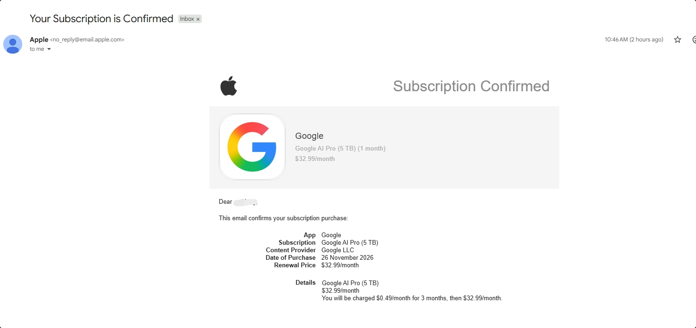
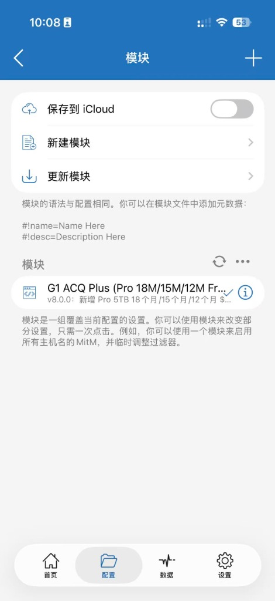
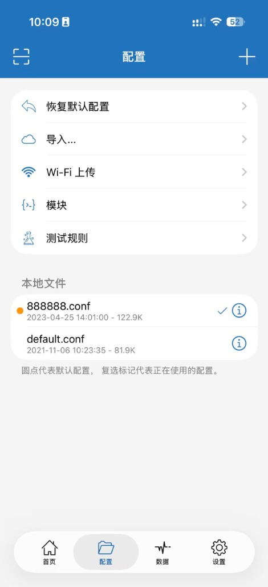
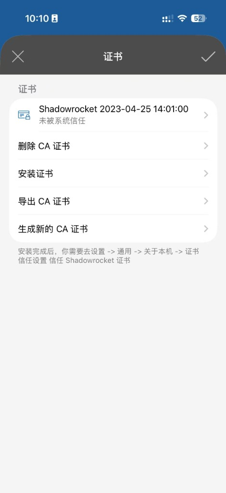
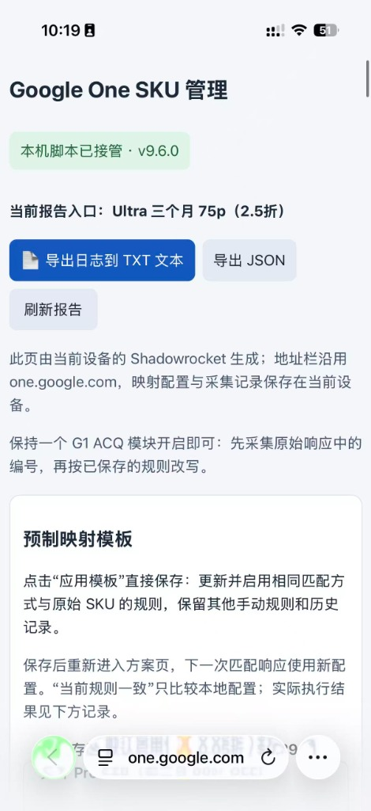
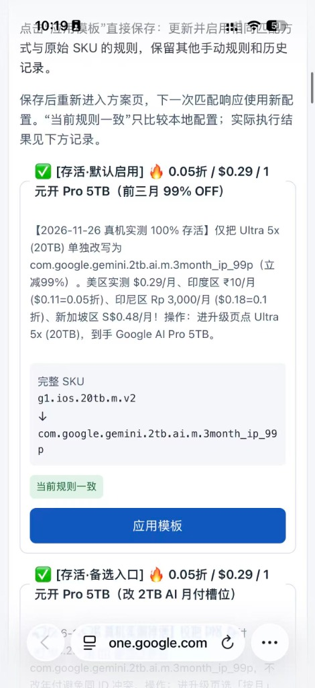
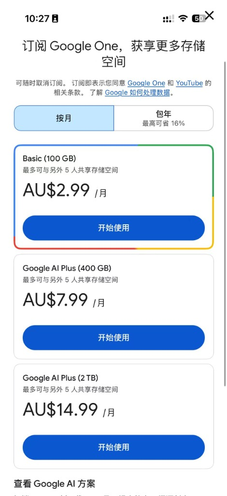

# iOS + Shadowrocket 低价开通 Google AI Pro（5TB）完整教程

> 本文基于开源项目 [`tgai521/g1-acq-plus`](https://github.com/tgai521/g1-acq-plus)（上游 `Dgkncn/g1-acq-plus` / `crhywun/g1-acq`）整理。利用 Shadowrocket 的 HTTPS 解密（MITM）能力改写 `one.google.com` 返回的商品 ID，拉起 App Store 的隐藏优惠 SKU（如前 3 个月 99% OFF / 0.05 折开 Google AI Pro 5TB）。

**实测订阅成功效果：**



---

## 零、开始前必须准备的东西（缺一不可）

在动手前，请先逐项确认你已经准备好以下 **6 样东西**：

| 序号 | 必备项 | 具体要求与说明 |
| :--- | :--- | :--- |
| 1 | **iPhone（iOS 设备）** | 本教程基于 iOS 端 App Store 内购流程。 |
| 2 | **Shadowrocket（小火箭）** | 需使用支持模块（`.sgmodule`）与 HTTPS 解密的 Shadowrocket（其他纯 Shadowsocks 客户端不支持）。 |
| 3 | **可用的海外代理节点** | 需为**支持 Google AI / Gemini 的地区节点**（如美国、澳洲、日本、新加坡等），**不能使用香港节点**。 |
| 4 | **外区 Apple ID** | iPhone 的 App Store 需登录支持 Google One 订阅的外区 Apple ID（如美区、澳区、新加坡区、印度区等），且账户内**已有余额或绑定可用支付方式**。国区 Apple ID 无法订阅（系统 iCloud 可保持国区，仅在「设置 → Apple ID → 媒体与购买项目」中登录外区 ID 即可）。 |
| 5 | **Google App（彩色 G 图标）** | 在 App Store 下载安装官方 **Google** App（注意是「Google」，不是 Chrome）。 |
| 6 | **目标 Google 账号** | 你打算开通 Google AI Pro 会员的 Google 账号（归属地不在受限地区即可）。 |

> **关于外区 Apple ID 支付 / 充值方式（二选一即可）**：
> 1. **礼品卡充值（推荐，门槛最低）**：打开 **支付宝** 搜索 **`nediya`**，购买对应外区最低额度的 Apple 礼品卡并兑换到外区 Apple ID 余额中即可。
> 2. **国际虚拟信用卡**：也可以前往 **Bybit Global** 申请一张国际虚拟信用卡绑定到外区 Apple ID 使用：[点击通过邀请链接注册 Bybit Global](https://www.bybitglobal.com/invite?ref=KE3W6A2&medium=referral&utm_campaign=evergreen)（详细开卡与充值步骤见：[Bybit Card 虚拟信用卡申请教程](./bybit-card-tutorial.md)）。

> **关于「三者区域是否要一致」的说明**：
> **Apple ID 地区、Google 账号归属地、代理节点地区不需要严格同区**，只要三者都避开不支持 Gemini 的地区即可：
> - **Apple ID 地区**：决定最终扣款币种和折扣价格（例如澳区扣澳元、美区扣美元）。
> - **代理节点地区**：决定能否正常加载 Google AI 方案页。
> - **Google 账号地区**：走 Apple 内购不校验 Google Play 付款资料，只要账号本身不在受限区即可正常享受权益。

---

## 一、在 Shadowrocket 中添加并启用模块

1. 打开 **Shadowrocket**，点击底部导航栏的 **「配置」**。
2. 点击列表中的 **「模块」**。
3. 点击右上角 **`+`**，粘贴以下模块直链并确认添加：
   ```text
   https://raw.githubusercontent.com/tgai521/g1-acq-plus/main/g1-acq-v8.sgmodule
   ```
4. 下载完成后，在下方「模块」列表中点击 **`G1 ACQ Plus`**，确认其右侧出现 **蓝色 `✓`**（代表已启用）。



---

## 二、开启 HTTPS 解密（MITM）并安装信任证书

> **新手最易踩坑点**：「HTTPS 解密」开关不在「模块」页面里，必须先返回「配置」主页面，且要点**当前正在使用的配置文件**右侧的 `(i)`。

1. 点击左上角 **`<`** 返回 **「配置」** 主页面。
2. 在「本地文件」中找到**右侧带蓝色 `✓`**（正在使用）的配置文件（可能是 `default.conf`，也可能是你导入的其他 `.conf` 文件），点击它最右边的 **`(i)`**。
3. 往下找到并点击 **「HTTPS 解密」**：
   - 打开顶部的 **「HTTPS 解密」** 开关。
   - 点击 **「证书」** → 建议先点击 **「生成新的 CA 证书」**（避免旧配置文件自带的证书过期或不安全）→ 点击 **「安装证书」**。
   - 自动跳转 Safari 提示下载描述文件时，点击 **「允许」**。
4. 前往 iPhone 系统 **「设置」** 完成证书安装与信任（**以下两步缺一不可**）：
   - **第 1 步（安装描述文件）**：打开系统 **设置** → 点击顶部的 **「已下载描述文件」**（若顶部未显示，去 `通用 → VPN 与设备管理` 中找到）→ 点击 Shadowrocket 证书并按提示 **安装**（需输入锁屏密码）。
   - **第 2 步（完全信任证书）**：进入系统 **设置 → 通用 → 关于本机 → 证书信任设置**（滑到页面最底部）→ 打开 Shadowrocket 根证书右侧的开关。
5. 切回 Shadowrocket：
   - 确认证书页面下方已变为 **「已被系统信任」**，点击右上角 **`✓`**。
   - 确认上一页「HTTPS 解密」开关为开启状态，再点击右上角 **`✓`** 保存配置。

<p>
  
  
</p>

---

## 三、开启代理并验证脚本接管成功

1. 切换到 Shadowrocket 底部 **「首页」**：
   - 选择一个支持 Gemini 的代理节点（如美国或澳洲节点）。
   - 确认 **全局路由** 为 **「配置」**（不要选「直连」）。
   - 打开最顶部的代理连接总开关（状态栏出现 VPN 图标）。
2. 打开 iPhone 自带的 **Safari** 浏览器，访问本机管理控制台：
   ```text
   https://one.google.com/g1-sku-report
   ```
3. 页面顶部如果出现绿色标签 **`本机脚本已接管 · v9.6.0`**（版本号随上游更新可能变化），说明模块与 HTTPS 解密已全部配置成功。
4. 向下滑动到 **「预制映射模板」**：
   - 确认第一个模板 **`[存活·默认启用] 0.05折 / $0.29 / 1元开 Pro 5TB（前三月 99% OFF）`** 上方已显示绿色的 **`当前规则一致`**。
   - 该模板已默认启用，**无需额外点击「应用模板」**，直接进入下一步即可。

<p>
  
  
</p>

---

## 四、在 Google App 中拉起优惠并订阅

1. 打开 **Google App**（彩色 G 图标），登录你准备好的目标 **Google 账号**。
2. 点击右上角**头像** → 点击 **「Google One」**（或存储空间 / 升级方案）。
3. 进入方案列表后**一直往下滑**，展开底部的 **「查看 Google AI 方案」**。

   

4. 找到 **Ultra (20TB)**，点击它下方的 **「开始使用」**。
   - **为什么点 20TB？** 默认模板借用了 `20TB` 按钮的槽位来触发隐藏 SKU，避免与原 Pro 槽位冲突；**最终订阅到手的仍然是 Google AI Pro（5TB），不是 20TB Ultra**。
   - **备选方案**：如果方案页里找不到 20TB 选项，切回 Safari 控制台点击第二个模板 **`[存活·备选入口] 改 2TB AI 月付槽位`** 的 **「应用模板」**，然后把 Google App 从后台彻底划掉重开，重新进入升级页并在「按月」中直接点 **Google AI Pro (5TB)**。
5. **仔细核对弹出的 App Store 付款窗口**（不双击侧边键不会扣费）：
   - 确认商品名称为 **Google AI Pro**。
   - 确认价格显示为**前 3 个月 99% OFF 折后价**（例如美区 `$0.29/月`，澳区、新加坡区等会显示对应币种的极低折扣价）。
   - 核对无误后双击侧边键确认付款，即可订阅成功。
   - *如果弹窗显示的仍是原价，请直接点取消，参考下方「常见问题」排查。*

---

## 五、订阅成功后的收尾工作（强烈建议立即完成）

1. **按需取消自动续费，防止第 4 个月原价扣款**
   - 前 3 个月优惠期结束后会自动按原价续费。若不打算原价续订，立即前往 iPhone **设置 → 顶部 Apple ID → 订阅 → Google One → 取消订阅**（取消后已付费的周期仍可正常使用）。
2. **关闭模块与 HTTPS 解密，保障日常安全**
   - 回到 Shadowrocket → **配置 → 模块** → 取消勾选 `G1 ACQ Plus`。
   - 回到当前配置文件的 `(i)` → **HTTPS 解密** → 关闭总开关并保存。

---

## 六、常见问题排查（FAQ）

1. **页面卡片上显示的还是原价，是不是失败了？**
   - 正常现象。页面卡片上的文字价格可能不会变化，脚本改写的是点击按钮后发给 App Store 的商品 ID，**一切以弹出的 App Store 原生付款窗口为准**。
2. **弹出 App Store 窗口后显示的仍是原价怎么办？**
   - **排查步骤 1**：把 Google App 从后台彻底划掉重开，再进升级页重新点一次。
   - **排查步骤 2**：切回 Safari 打开 `https://one.google.com/g1-sku-report`，点击 **「刷新报告」**，滑到底部查看改写记录，确认是否命中并改写为 `com.google.gemini.2tb.ai.m.3month_ip_99p`。
   - **排查步骤 3**：如果记录显示脚本已成功改写、弹窗商品也变成了 Google AI Pro，但价格仍为原价，说明当前 Apple ID 所在区未配置该折扣或该账号已领过同类促销（不符合新客/优惠资格）。
3. **中国大陆区 Apple ID 可以订阅吗？**
   - 不可以。国区 App Store 未上架 Google App / Google One，也无对应 SKU 定价。但系统 iCloud 可以保持国区，仅在 App Store（媒体与购买项目）中切换外区 Apple ID 即可。
4. **安全与时效提示**
   - 本方法依赖上游隐藏促销 SKU，官方随时可能下架或调整资格；且模块远程加载第三方脚本，请务必以 App Store 弹窗实付金额为准，用完及时关闭模块与 HTTPS 解密。

---

## 七、微信交流群

使用过程中遇到问题或想交流更多优惠方案，欢迎扫码进群交流：

<!-- 将你的微信群二维码图片保存到 ./images/wechat-group-qr.jpg 后即可显示 -->


